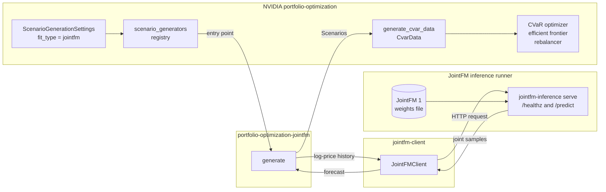

# portfolio-optimization-jointfm

JointFM as a scenario generator for NVIDIA's [portfolio-optimization](https://github.com/NVIDIA-AI-Blueprints/portfolio-optimization) package. Installing this package makes `fit_type="jointfm"` available wherever the package takes a `ScenarioGenerationSettings`. Its Mean-CVaR optimizer, efficient frontier, and rebalancing backtests then draw their return scenarios from JointFM 1, served on your own machine by the [JointFM inference runner](https://github.com/datarobot-oss/joint-inference-python) and called through the [`jointfm-client`](https://pypi.org/project/jointfm-client/) SDK.

The package plugs into the scenario-generator extension point of NVIDIA's package (`portfolio_optimization.scenario_generators`) through an entry point. NVIDIA's code therefore carries no JointFM code: selecting JointFM is one setting.

## How it works

Four projects take part, and each box below is one of them. NVIDIA's package and this package run in the same Python environment. The runner is a separate process that the client reaches over HTTP.



NVIDIA's package does not depend on this package: it finds the generator through the entry point that this package declares when it is installed. This package depends on `jointfm-client` from PyPI. The runner loads the weights file and serves them to any client.

1. `ScenarioGenerationSettings(fit_type="jointfm")` looks the name up in the scenario-generator registry, which finds this package through its installed entry point.
2. The generator rebuilds each asset's log-price path from the look-back window's returns and sends all assets in one sample request through `jointfm-client`.
3. The runner returns joint draws of the next log prices. The generator turns each draw into a next-period return, and NVIDIA's package uses the draws as CVaR scenarios.

## Requirements

- Linux or macOS with [uv](https://docs.astral.sh/uv/), [Task](https://taskfile.dev/), git, and curl.
- A JointFM 1 serving weights file for the runner; the runner's README says how to obtain one. The runner loads only weights made for its own release.
- For GPU runs, an NVIDIA GPU with CUDA 12 or 13: cuOpt solves the CVaR problems and cuML fits the KDE baseline. Everything also runs on CPU, with the CLARABEL solver and the KDE baseline on scikit-learn.

Install uv and Task with curl if you do not have them. Both install into `~/.local/bin`, which must be on your `PATH`, and uv provides Python itself:

```sh
curl -LsSf https://astral.sh/uv/install.sh | sh
sh -c "$(curl --location https://taskfile.dev/install.sh)" -- -d -b ~/.local/bin
uv --version && task --version
```

The steps clone the three repositories side by side into one workspace folder:

```text
workspace/
├── joint-inference-python/           # step 1: the JointFM runner
├── portfolio-optimization/           # steps 2 to 5: NVIDIA's package
└── portfolio-optimization-jointfm/   # step 3: this package
```

Every step starts in the workspace folder and changes into the repository it works in.

## 1. Serve JointFM locally

```sh
git clone https://github.com/datarobot-oss/joint-inference-python.git
cd joint-inference-python
cp .env.template .env
```

Edit `.env`:

```sh
JOINTFM_INFERENCE_CHECKPOINT_PATH=/absolute/path/to/jointfm-1.pt
JOINTFM_INFERENCE_DEVICE=cuda:0           # or cpu
JOINTFM_INFERENCE_MAX_SAMPLE_COUNT=2000   # at least the scenario count you request
```

`JOINTFM_INFERENCE_MAX_SAMPLE_COUNT` caps the samples one request may ask for, 1,000 by default. The client splits a larger request into several, and each costs one more forward pass, so set the cap to at least the scenario count you plan to request. The runner's README documents every setting, including downloading the weights from a URL.

Start the service, then check it from a second shell:

```sh
task serve                               # stop with Ctrl-C
task probe                               # second shell: requests every return mode
curl -s http://127.0.0.1:8080/healthz
```

`/healthz` should report `"status": "ok"`, `"generation": "jointfm-1"`, `"schema_version": "v6"`, and your `max_sample_count`. Its `data_generation` section sets the limits of a scenario request: `max_series` is the largest number of assets in one request, and `n_input` is the number of most recent history points the model reads.

## 2. Install NVIDIA's package with the extension point

NVIDIA's package is not on PyPI, so install it from its repository. The scenario-generator extension point is not on NVIDIA's `main` branch yet; until it is, check out commit `7d0bfc8`, the revision that introduces it. Any later revision that has `src/scenario_generators.py` works as well.

```sh
git clone https://github.com/NVIDIA-AI-Blueprints/portfolio-optimization.git
cd portfolio-optimization
git fetch origin 7d0bfc8326802c443b296270034e3259212f6450
git checkout -b scenario-generators FETCH_HEAD
uv sync --extra cuda13    # CUDA 13; --extra cuda12 for CUDA 12; no extra for CPU only
```

## 3. Install this package

Clone this repository into the workspace, then install it into the environment of NVIDIA's package:

```sh
git clone https://github.com/datarobot-oss/portfolio-optimization-jointfm.git
cd portfolio-optimization
uv pip install -e ../portfolio-optimization-jointfm
uv run python -c "from portfolio_optimization import scenario_generators as g; print(g.available())"
```

The last command prints `['gaussian', 'jointfm', 'kde', 'no_fit']`. This package is not in NVIDIA's lockfile, so `uv sync` removes it again, while `uv run` keeps it. Reinstall it after every `uv sync`.

For scripts, `uv run --with` adds this package for one command instead, without installing it, so it survives every `uv sync`:

```sh
uv run --with ../portfolio-optimization-jointfm python example.py
```

A notebook kernel runs the checkout's own `.venv`, so notebooks need the installed package.

## 4. Point the client at the runner

`jointfm-client` reads where JointFM runs from `.env` in the working directory. In NVIDIA's package, start from NVIDIA's sample, which selects the GPU, and add the two client settings:

```sh
cd portfolio-optimization
cp .env.sample .env
cat >> .env <<'EOF'
JOINTFM_LOCAL_BASE_URL=http://127.0.0.1:8080
JOINTFM_SCHEMA_VERSION=v6
EOF
```

The client retries an unreachable service 20 times with backoff of up to 60 seconds, so a call against a stopped runner waits for minutes before it fails. To fail within seconds while testing, add a `config.yaml` next to `.env`:

```yaml
transport:
  retry:
    max_attempts: 2
```

## 5. Use JointFM in code

Choosing JointFM is one setting; every workflow that takes `ScenarioGenerationSettings` then uses it. The example below runs in NVIDIA's package, where step 4 put the `.env` the client reads. It reads the Dow 30 prices, which NVIDIA's helper downloads from Yahoo Finance into `data/stock_data/dow30.csv`:

```sh
cd portfolio-optimization
uv run python -c "from portfolio_optimization.utils import download_data; download_data('data/stock_data', datasets=['dow30'])"
```

Save the example as `example.py` in the same folder and run it with `uv run python example.py`:

```python
import cvxpy as cp
from portfolio_optimization import cvar_optimizer, utils
from portfolio_optimization.cvar_parameters import CvarParameters
from portfolio_optimization.cvar_utils import generate_cvar_data
from portfolio_optimization.settings import (
    ReturnsComputeSettings,
    ScenarioGenerationSettings,
)

prices = utils.get_input_data("data/stock_data/dow30.csv").tail(253)
returns_dict = utils.calculate_returns(
    prices, None, ReturnsComputeSettings(return_type="LOG")
)
settings = ScenarioGenerationSettings(num_scen=2000, fit_type="jointfm", seed=0)
returns_dict = generate_cvar_data(returns_dict, settings)

cvar_params = CvarParameters(
    w_min=0.0, w_max=0.25, c_min=0.0, c_max=0.0, risk_aversion=1.0, confidence=0.95
)
result, portfolio = cvar_optimizer.CVaR(
    returns_dict, cvar_params
).solve_optimization_problem(
    solver_settings={"solver": cp.CUOPT, "verbose": False, "solver_method": "PDLP"},
    print_results=False,
)
```

- **Without a GPU**, solve on CPU with `solver_settings={"solver": cp.CLARABEL, "verbose": False}`.
- **Efficient frontier:** pass the same `returns_dict` to `cvar_utils.create_efficient_frontier`.
- **Rebalancing:** pass the same `settings` to `rebalance.rebalance_portfolio`. It requests JointFM once for the initial portfolio and once per re-optimization.

### Switching a workflow to JointFM

**Rule:** change only the `ScenarioGenerationSettings` the workflow builds:

- set `fit_type="jointfm"`;
- remove the settings of the generator that JointFM replaces, such as `kde_settings`;
- add `generator_options={"dotenv_path": ...}`, naming the `.env` with the client settings relative to the working directory of the process that runs the workflow.

Leave every other argument (`num_scen`, `seed`, `verbose`) and every call that receives the settings unchanged.

`dotenv_path` defaults to `.env` in the working directory, and a missing file is skipped. A notebook kernel runs in the notebook's folder, so NVIDIA's notebooks in `notebooks/` need `"../.env"`; without it, the first JointFM request fails with `JOINTFM_SCHEMA_VERSION is required`. For example, NVIDIA's `notebooks/rebalancing_strategies.ipynb` builds its KDE settings like this:

```python
rebal_scenario_generation_settings = ScenarioGenerationSettings(
    num_scen=10000,  # Number of return scenarios to simulate
    fit_type="kde",
    kde_settings=KDESettings(bandwidth=0.01, kernel="gaussian", device="GPU"),
    verbose=False,
)
```

and switches to JointFM like this, with both rebalancing strategies unchanged:

```python
rebal_scenario_generation_settings = ScenarioGenerationSettings(
    num_scen=10000,  # Number of return scenarios to simulate
    fit_type="jointfm",
    generator_options={"dotenv_path": "../.env"},
    verbose=False,
)
```

Before switching, check that the workflow meets the generator's requirements, listed below. A runner whose `JOINTFM_INFERENCE_MAX_SAMPLE_COUNT` is below `num_scen` still answers, but needs one forward pass per `max_sample_count` scenarios.

### Options and requirements

The generator's own options go into `generator_options`, for example `generator_options={"expected_return": "historical"}`:

| Option | Default | Meaning |
| --- | --- | --- |
| `expected_return` | `"scenario"` | `"scenario"` takes the expected returns from the mean of the JointFM scenarios; `"historical"` uses the look-back window's mean, as the built-in generators do |
| `dotenv_path` | `".env"` | `.env` file the client reads; `None` reads only the process environment |
| `config_path` | `"config.yaml"` | `jointfm-client` configuration file, such as the retry settings of step 4; a missing file is skipped |

Unknown options are refused. The generator needs one-period returns, `LOG` or `LINEAR` with `freq=1`, because it rebuilds price paths from them. It sends all assets in one request, so the universe must fit `max_series`. It sends at most the `n_input` most recent points of the window. Because it converts forecast log prices back into returns, no scenario implies a non-positive price. `seed` is forwarded to the runner, so repeated requests with the same seed to one running service return the same scenarios; after a restart of the service, the draws can differ slightly.

## Troubleshooting

| Message or symptom | Cause | Fix |
| --- | --- | --- |
| `Unknown fit_type 'jointfm'; available scenario generators: [...]` | This package is not installed in the environment, or `uv sync` removed it | Step 3 |
| `ImportError: cannot import name 'scenario_generators' from 'portfolio_optimization'`, or `fit_type` `Input should be 'gaussian', 'kde' or 'no_fit'` | NVIDIA's package is at a revision without the extension point | Step 2 |
| `JointFMConfigurationError: JOINTFM_SCHEMA_VERSION is required` | The client found no `.env` with its settings at `dotenv_path`, which is resolved from the working directory; a notebook runs in its own folder | Step 4, and set `generator_options={"dotenv_path": "../.env"}` in notebooks (see *Switching a workflow to JointFM*) |
| A scenario call hangs for minutes, then `JointFMRequestError: JointFM HTTP request failed: ... Connection refused` | The runner is not running at `JOINTFM_LOCAL_BASE_URL` | Check `curl http://127.0.0.1:8080/healthz`; step 4 shortens the retries |
| `ValidationError: 1 validation error for JointFMSettings ... Extra inputs are not permitted` | A misspelled key in `generator_options` | Use the option names of step 5 |
| `fit_type='jointfm' forecasts all assets jointly in one request, and the served model accepts 1 to 100 series; got N assets` | The universe is larger than the runner's `max_series` | Select fewer assets |
| `fit_type='jointfm' needs return_type in ('LOG', 'LINEAR')` or `needs one-period returns (freq=1)` | Returns without a price level, or overlapping multi-period returns | Compute returns with `return_type="LOG"` or `"LINEAR"` and `freq=1` |
| `task serve` exits with `RuntimeError: Error(s) in loading state_dict for JointFM` | The weights file was made for another runner release | Use weights that match your runner release |

## Develop

```sh
cd portfolio-optimization-jointfm
task setup         # installs NVIDIA's package from git as a development dependency, and the commit hooks
task test          # runs on CPU against a fake JointFM client; no runner needed
task lint          # ruff check; task format rewrites files with ruff format
task pre-commit    # every commit hook on all files
```

Every commit runs ruff lint with fixes, ruff format, and the full test suite, and is refused when any of them fails or changes a file; stage the changes and commit again. `task setup` installs these hooks, so it runs only in a git clone. `task` alone lists every target.

The tests check that the installed entry point is found, that every request carries a log-price path, that the options reach the client, that misspelled options are refused, and that solves and a rebalancing run work on JointFM scenarios.

## License

Apache License 2.0, see [LICENSE](LICENSE).
